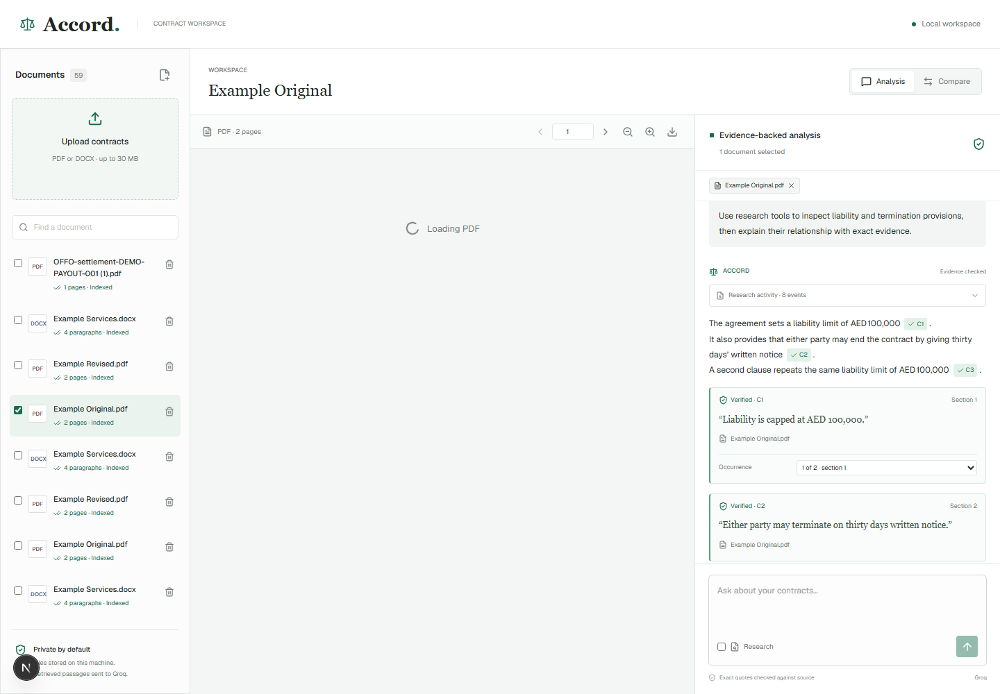
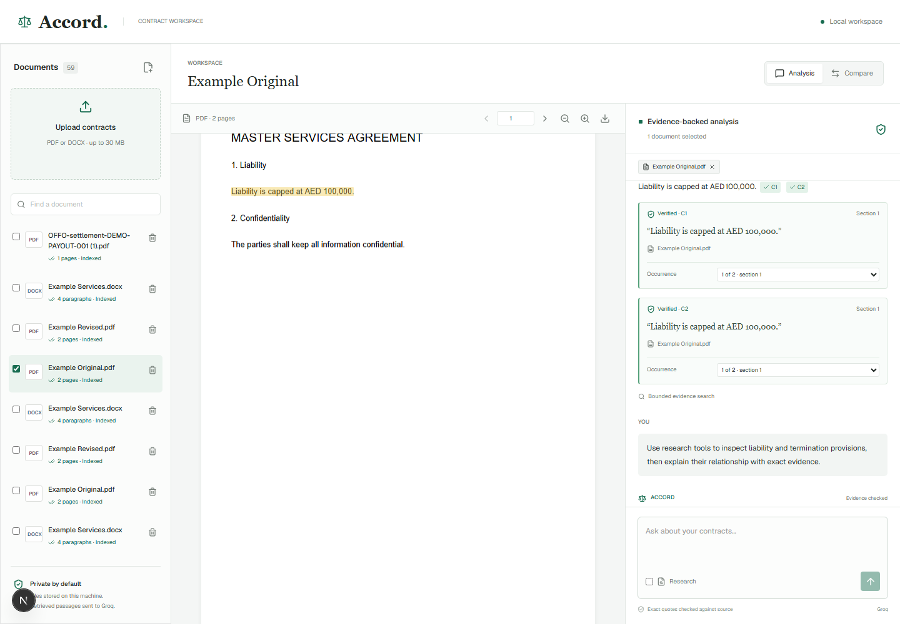
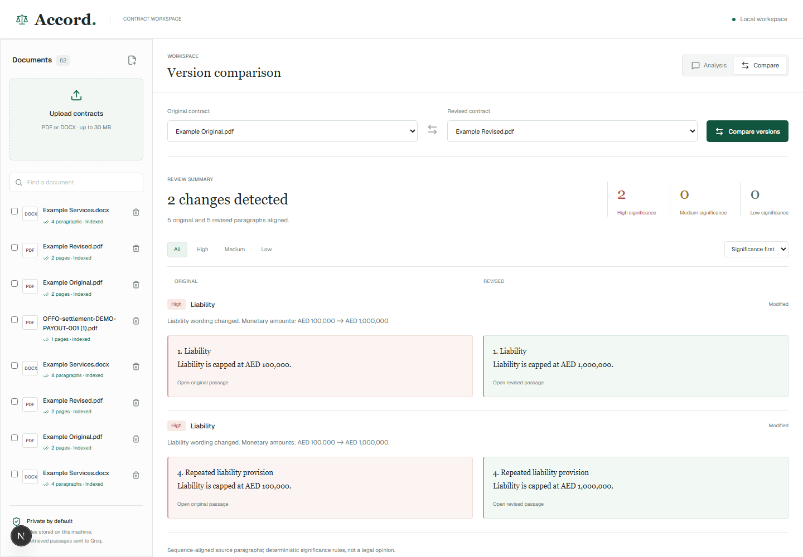
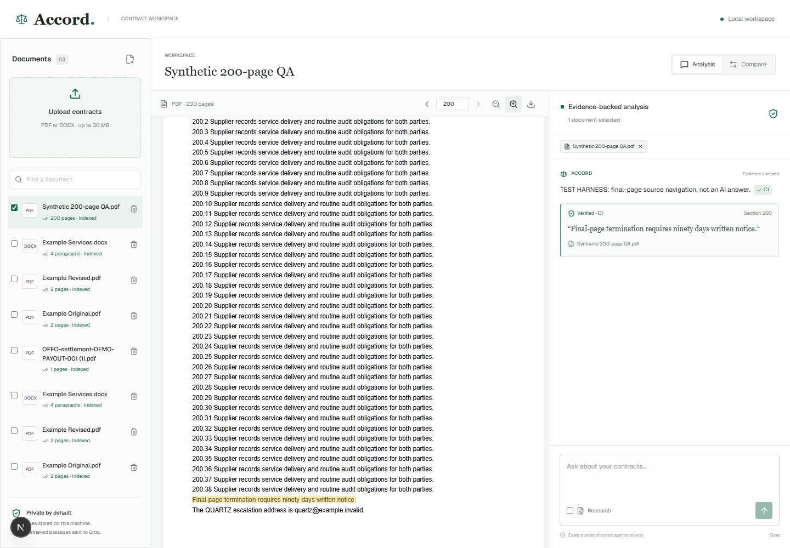

# Accord

### Contract analysis with evidence you can inspect.

Accord is a single-user workspace for reviewing PDF and DOCX contracts. Ask a question, inspect the supporting quotations, jump to the highlighted source, and compare two versions without leaving the document workspace.

**The central engineering decision: the model proposes evidence; application code decides whether that evidence is valid.** A generated quote is never trusted because the model supplied a convincing answer, page number, or offset.

Built with **Next.js App Router, TypeScript, Groq/Gemini, SQLite FTS5, PDF.js, and Mammoth**. No account system or external database is required.

[Source Repository](https://github.com/Revanthkaki/PDF_Chatbot_ai) | [Run Locally](#run-locally) | [Tested Results](#tested-results)



## At A Glance

| Capability | What it does |
| --- | --- |
| Document workspace | Upload, process, open, download, and delete PDF/DOCX files with persistent status and history. |
| Evidence-backed chat | Stream answers, stop generation, retain partial drafts, and finalize only source-verified evidence. |
| Source navigation | Highlight exact passages, including multiline, repeated, and cross-page PDF quotations. |
| Multi-document analysis | Retrieve independently from each selected document and verify citations against their own source. |
| Version comparison | Align paragraphs, explain changes, and filter/sort by significance. |
| Agentic research | Let the model choose tools across multiple rounds, with visible activity and enforced execution limits. |
| Large-file processing | Index overlapping chunks rather than send the entire contract in one request; expose partial-search coverage. |

## Verification, Not Just Generation

A genuine quotation and a correct legal interpretation are different things. Accord verifies the former and makes the latter available for human review.

1. **Retrieve by document.** Each selected contract gets its own bounded evidence search, preventing one document from crowding out another.
2. **Stream an unverified draft.** Text appears immediately, but citation placeholders do not imply that verification has finished.
3. **Request exact quotations.** The model maps draft placeholders to source text, not trusted page numbers or offsets.
4. **Locate evidence in code.** Whitespace-normalized matching retains a map back to original character positions and finds every exact occurrence.
5. **Enforce the evidence boundary.** Quotes must belong to the cited document and be covered by retrieved source ranges. Unsupported final paragraphs are removed.
6. **Navigate without guessing.** The viewer checks extracted-page text against the rendered text layer before drawing highlight rectangles.

Fabricated quotes, paraphrases, wrong-document evidence, and genuine quotes from unexamined sections are rejected. Cancelled or failed drafts remain explicitly unverified.



## Engineering Decisions

### Large Documents: Bounded Retrieval, Honest Coverage

The background worker extracts pages or paragraphs, preserves source ranges, and builds overlapping word-boundary chunks in SQLite FTS5. Ordinary chat retrieves up to six chunks per selected document; research retains at most 30 unique evidence chunks.

The UI reports retrieved versus indexed coverage. A partial search is not presented as a whole-contract review, and failure to retrieve a clause is not proof that the clause does not exist.

### Research: A Real Tool Loop

**Part C choice: Option 2, agentic document research.** I chose this because evidence acquisition is as important as answer generation: users should be able to see what the model inspected.

The model starts with document metadata, chooses tools, reads actual results, and can request more evidence before answering:

- `search_document`: retrieve relevant passages.
- `get_section`: inspect a specific source section.
- `list_clauses`: identify candidate contract clauses.
- `get_document_coverage`: inspect retrieval coverage.

Zod validates arguments and selected-document IDs. Unknown or malformed calls produce bounded errors rather than crashing the request. The loop has a hard limit of **three rounds and six tool executions**, including invalid attempts. Final answers use the same verification pipeline as ordinary chat.

### Persistence: Recoverable Work, Not In-Memory Jobs

Web and worker processes share a durable SQLite database and original-file directory. Transactional job claims use a 20-minute lease and a maximum of three attempts. Interrupted processing can be reclaimed; a late worker result cannot resurrect a deleted document.

This is intentionally a persistent, single-user Node service, not an ephemeral serverless architecture.

### Comparison: Useful Rules With Explicit Boundaries

Paragraph alignment and deterministic significance rules distinguish monetary changes, durations, obligations, exceptions, additions, and removals. Simple clause renumbering is separated from substantive numeric changes.

For example, **AED 100,000 -> AED 1,000,000** is treated as a high-significance liability change, not a cosmetic edit. Comparison is capped at 12,000 paragraphs per version, with a five-second alignment timeout and explicit coverage reporting.



## Tested Results

**Latest local verification: October 10, 2026.** These results describe tested cases, not a guarantee for every contract or PDF layout.

| Check | Result |
| --- | --- |
| Backend regression suite | **40 tests passed** across six test files. |
| Browser regression suite | **14 tests passed**, including mobile layout and provider hydration. |
| Lint, TypeScript, production build | Passed during the latest implementation checks. |
| Live Groq ordinary chat | Completed with two source-verified citations. |
| Live Groq research | Completed with three verified citations and three tool calls. |
| Live Groq 150-page final-page answer | Passed with verified evidence from page 150. |
| Dense 150/200-page PDF browser workflows | Upload, indexing, rendering, final-page highlighting, and zoom passed. |
| 200-page version comparison | Detected the liability-cap change on page 199. |
| Live Groq 200-page answer | **Incomplete:** citation verification hit HTTP 429. Large-file live research and cross-version checks remain unverified in that run. |

The generated 150-page fixture contains **508,208 extracted characters**; the 200-page original contains **678,958**. These are actual multipage PDFs, not small files renamed to imply scale.

Tests also cover malformed requests, unreadable files, duplicate uploads, mixed blank/text coverage warnings, persistence, worker recovery, exact downloads, deletion, repeated/cross-page quotations, and rotated, landscape, mixed-font PDF layouts.

The chat screenshots above come from successful **real-provider** verification using synthetic, nonconfidential contracts. Browser citation fixtures use explicitly labeled test-harness history; they do not demonstrate live AI output.



## Run Locally

Requires **Node.js 24 and npm**. Run these commands from the application directory containing this README. If your checkout contains a parent workspace, enter `legal-workspace` first.

```powershell
npm ci
# Only create the local environment file if one does not already exist:
if (-not (Test-Path .env.local)) { Copy-Item .env.example .env.local }
```

Configure a provider in `.env.local`. For Groq:

```env
AI_PROVIDER=groq
GROQ_API_KEY=your_api_key
GROQ_MODEL=openai/gpt-oss-120b
GROQ_BASE_URL=https://api.groq.com
```

Get a key from [Groq Console](https://console.groq.com/keys). Choose a model available to your account. The SDK adds `/openai/v1/chat/completions` to the configured base URL.

For Gemini, set `AI_PROVIDER=gemini`, `GEMINI_API_KEY`, and a `GEMINI_MODEL` available to your project. Keys are server-only; `.env.local` is ignored and the shareable template contains no credentials. Never commit keys; revoke any exposed credential.

```powershell
npm run dev
```

Open **http://localhost:3000**. This command starts both Next.js and the processing worker. SQLite tables and indexes are created automatically. Uploads, viewing, persistence, and comparison work without an AI key; chat reports missing configuration clearly. Restart after changing provider settings if they are not picked up automatically.

| Environment Variable | Purpose |
| --- | --- |
| `AI_PROVIDER` | Select `groq` or `gemini`; unset selects Gemini for legacy configurations. |
| `GROQ_API_KEY`, `GROQ_MODEL`, `GROQ_BASE_URL` | Groq credentials, model, and API origin. |
| `GEMINI_API_KEY`, `GEMINI_MODEL`, `GEMINI_BASE_URL` | Gemini credentials, model, and API endpoint. |
| `DATA_DIR` | Shared persistent storage; defaults to `./data`. |
| `MAX_UPLOAD_MB` | Upload limit; defaults to 30 MB, configurable up to 100 MB. |
| `PORT` | Web port; defaults to `3000`. |

## Reproduce The Checks

```powershell
npm run test
npm run typecheck
npm run lint
npm run build
npx playwright install chromium
# Keep npm run dev running in another terminal:
npm run test:e2e
# Real-provider checks require a configured key and consume provider quota:
npm run verify:ai
npm run verify:ai -- --large
```

The browser suite generates the synthetic contract fixtures used by live verification. `verify:ai` checks ordinary answers, actual research tool use, and verified evidence, then captures chat/research screenshots. `--large` checks late-page answers, 200-page research, and cross-version citations. It fails on incomplete or unverified results rather than counting a partial answer as success.

Development output is isolated in `.next-development`; production builds use `.next`, avoiding stale client assets when building while the dev server is running.

HTTP 429 indicates provider quota or rate limits. Failed drafts remain unverified, and quota errors are not automatically retried. Check provider usage before rerunning live verification. Changing keys within the same provider project does not necessarily change its quota.

## Architecture And Deployment

```text
Browser workspace
	-> Next.js API -> SQLite metadata, history, FTS5 + original files
	-> Background worker -> PDF/DOCX extraction -> source ranges + chunks
	-> Provider adapter -> bounded research / streamed draft
	-> Server quotation verifier -> evidence-backed final answer
	-> PDF.js / DOCX viewer -> exact source navigation
```

See [architecture](docs/ARCHITECTURE.md) and [database setup](docs/DATABASE.md) for implementation details. Back up the entire data directory, including originals, and keep web and worker on the same persistent volume.

Deploy to a persistent Node service such as Railway, Render, or a VM. Build with `npm ci` and `npm run build`; run with `npm start`. Runtime scripts require `tsx` and `concurrently`, so do not omit dev dependencies without changing that packaging. Plain ephemeral serverless hosting requires a storage and worker migration.

An included Dockerfile provides a deployment starting point:

```powershell
docker build -t accord .
docker run --env-file .env.local -e DATA_DIR=/app/data -p 3000:3000 -v accord-data:/app/data accord
```

**Deployment status:** no public deployment is supplied yet. The Docker image has not been built or runtime-verified in this environment. Verify processing and persistence after a service restart before treating a deployment as ready.

## Limitations And Next Steps

- **No OCR:** image-only PDFs fail clearly; mixed readable/blank pages carry a coverage warning.
- **Verification is not legal reasoning:** exact quote existence does not prove semantic entailment. Human review remains necessary.
- **Conservative source mapping:** spelling changes, ligatures, hyphenation, or ambiguous PDF text order can cause genuine evidence or highlights to be rejected rather than guessed.
- **Lexical retrieval:** synonyms and complex clauses can be missed. Semantic retrieval is a logical next step, but is not implemented.
- **DOCX viewing is text-oriented:** it does not reproduce Word's original visual formatting. Tracked-change redlining was not chosen for Part C.
- **Comparison is heuristic:** reordered clauses and dense tables can misalign; significance is not a complete legal-impact classifier.
- **Explicit resource limits:** up to 1,500 PDF pages, 12 million extracted characters, and six selected documents per question. Synthetic 150/200-page checks do not certify every layout.
- **Crash boundaries:** worker recovery waits for lease expiry. A hard process crash can leave a saved chat draft marked streaming, still unverified.
- **Single-user security model:** no authentication by assignment design. Protect public access and review upload handling and dependencies before accepting confidential or arbitrary third-party files. An earlier audit identified three moderate production and five high development findings; remediation is not claimed.

The next priorities are completing quota-dependent large-file live checks, verified persistent deployment, semantic retrieval, and stronger interpretation-level evidence checks. OCR and public multi-user hardening would need separate design work.

## Submission Materials

- [Demo script](docs/DEMO.md): outline for the required 3-5 minute recording; the actual video is pending.
- [Submission note](docs/SUBMISSION.md): verification approach, large-document strategy, and Part C rationale.
- [QA detail](docs/QA.md): earlier regression evidence and known boundaries. Some companion documents retain earlier provider/test status; the dated results in this README reflect the latest checks.
- Additional captures: [document library](docs/screenshots/document-library.png), [DOCX workspace](docs/screenshots/docx-workspace.png), [mobile workspace](docs/screenshots/mobile-workspace.png), and [live research](docs/screenshots/research-live.png).
